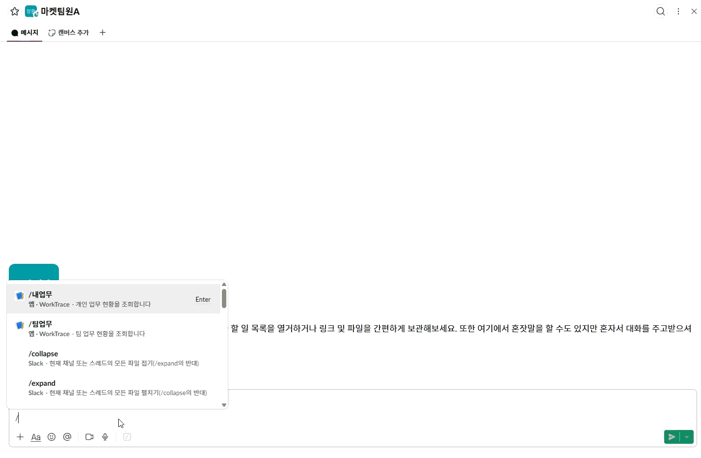
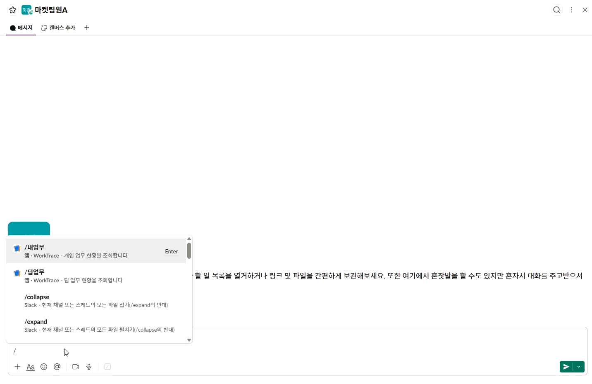

# WorkTrace

> Java·Spring Boot로 구현한 Slack–Notion 연동 업무 추적 자동화 백엔드

Slack의 메시지 바로가기, 이벤트, 슬래시 커맨드를 HTTP 엔드포인트로 처리하고 Notion REST API와 연동했습니다. 업무 등록부터 상태 변경, 개인·팀 현황 조회까지의 비즈니스 로직을 Spring Boot 애플리케이션으로 구현했습니다.

업무 요청은 Slack에서 빠르게 이루어지지만, 메시지가 쌓이면 담당자와 진행 상태를 놓치기 쉽습니다. WorkTrace는 기존 Slack 중심의 소통 방식을 유지하면서 필요한 메시지만 업무로 등록하고, Notion을 팀의 업무 보드로 활용합니다.

## 개발 배경

실제 업무에서는 다른 부서의 요청이나 고객 문의를 Slack 메시지로 전달하고 담당자를 태그해 처리했습니다. 하지만 메시지만으로 업무를 관리하면서 다음 문제가 반복됐습니다.

- 담당자와 처리 여부를 한눈에 확인하기 어려움
- 다른 사람이 처리했을 것이라 생각해 업무가 누락됨
- 오래된 요청이 대화에 묻혀 고객 대응이 지연됨
- 개인 및 팀 업무 현황을 매일 다시 정리해야 함

별도의 업무관리 도구를 새로 학습하거나 Slack 메시지를 다른 서비스에 반복해서 입력하지 않고도 이 문제를 줄일 수 있는지 검증하기 위해 MVP를 개발했습니다.

## 주요 기능

| 기능 | 설명 |
| --- | --- |
| 메시지 바로가기 | Slack 메시지에서 바로 업무 등록 모달을 실행합니다. |
| 입력값 자동 추출 | 원본 메시지 본문과 `cc` 전후의 담당자·참조자를 모달에 채웁니다. 업무명은 사용자가 직접 입력합니다. |
| Notion 자동 등록 | 업무명을 페이지 제목으로, Slack 메시지를 페이지 본문으로 저장합니다. |
| 중복 등록 방지 | 원본 Slack 메시지 URL로 이미 등록된 업무인지 확인합니다. |
| 이모지 상태 연동 | 담당자가 👀을 추가하면 `진행중`, ✅을 추가하면 `완료`로 변경합니다. |
| 개인 업무 조회 | `/내업무`로 미완료 업무와 오늘 완료한 업무를 확인합니다. |
| 팀 업무 조회 | `/팀업무`로 담당자별 업무와 현재 상태를 확인합니다. |

## 동작 화면

### 1. Slack 메시지를 Notion 업무로 등록

메시지 바로가기에서 `업무 등록`을 선택하면 담당자와 참조자를 추출하고, 사용자가 입력한 업무명과 원본 메시지 본문을 Notion에 저장합니다.


### 2. 이모지로 진행 상태 변경

담당자가 원본 메시지에 👀 또는 ✅ 이모지를 추가하면 연결된 Notion 업무의 상태가 변경됩니다. 담당자가 아닌 사용자의 반응은 상태에 반영하지 않습니다.


### 3. 개인 및 팀 업무 조회

별도 관리 화면에 접속하지 않고 Slack에서 바로 업무 현황을 확인합니다.

```text
/내업무  → 내 미완료 업무 + 오늘 완료 업무
/팀업무  → 담당자별 미완료 업무 + 오늘 완료 업무
```

조회 결과는 명령을 실행한 사용자에게만 보이는 메시지로 응답합니다.

#### 내 업무 현황



#### 팀 업무 현황


